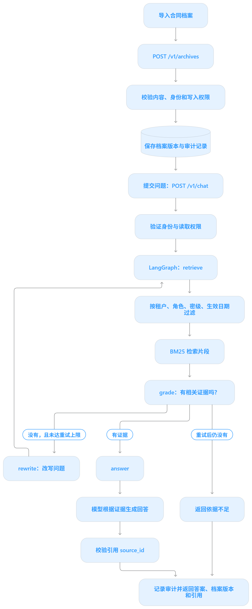

# Financial Agent：合同与合规档案问答

这是一个可运行的服务骨架：**档案入库 → 租户/角色/密级/生效日期过滤 → BM25 检索 → LangGraph 有界重试 → 带引用回答 → 审计记录**。默认使用本地 SQLite 和抽取式回答；没有模型密钥也能运行。示例档案均为虚构内容。

## 项目结构

```text
financial-agent/
├─ app/
│  ├─ agent/          # state.py / graph.py / nodes.py / prompts.py
│  ├─ services/       # archive.py / auth.py / parser.py / retrieval.py / llm.py
│  ├─ schemas/        # archive.py / chat.py
│  ├─ config.py
│  └─ main.py
├─ examples/contract.json
├─ tests/test_api.py
├─ requirements.txt
├─ .env
├─ .env.example
└─ .gitignore
```

## 启动

在 `financial-agent` 目录运行：

```powershell
py -3.12 -m venv .venv
.\.venv\Scripts\python.exe -m pip install -r requirements.txt
.\.venv\Scripts\python.exe -m uvicorn app.main:app --reload
```

在另一个终端提交示例档案并提问：

```powershell
py -3.12 -m examples.run_demo --tenant my-demo --question "提前还款需要提前多少天申请？"
```

如果 8000 端口已被占用，可把启动命令的端口改为 `--port 8001`，再用 `py -3.12 -m examples.run_demo --base-url http://127.0.0.1:8001 --tenant my-demo --question "提前还款需要提前多少天申请？"` 验证。若同一租户下该档案版本已有不同内容，使用新的演示租户或提升示例档案版本。

也可以分别调用接口：

```powershell
$headers = @{ Authorization = "Bearer example-only"; "X-Demo-Tenant" = "demo-tenant"; "X-Demo-Roles" = "archive_reader,archive_writer,legal"; "X-Demo-Clearance" = "restricted" }
$body = Get-Content .\examples\contract.json -Raw -Encoding UTF8
Invoke-RestMethod -Method Post -Uri http://127.0.0.1:8000/v1/archives -Headers $headers -ContentType "application/json; charset=utf-8" -Body $body
$question = @{ question = "提前还款需要提前多少天申请？"; as_of = "2026-10-30" } | ConvertTo-Json
Invoke-RestMethod -Method Post -Uri http://127.0.0.1:8000/v1/chat -Headers $headers -ContentType "application/json; charset=utf-8" -Body $question
```

上传接口为 `POST /v1/archives/upload`，接受 TXT、可提取文本的 PDF、DOCX；扫描版 PDF 需要先 OCR。`GET /health/live`、`GET /health/ready` 可用于健康检查；`/docs` 展示 OpenAPI 文档。

## 安全边界

- `APP_ENV=production` 时必须使用 JWT。设置 `AUTH_MODE=jwt`、`JWT_ISSUER`、`JWT_AUDIENCE`、`JWT_JWKS_URL`。生产 JWKS 只能用 HTTPS。租户、角色和密级只从已验证的 JWT 声明读取。
- 本地模式的 `X-Demo-*` 身份头和演示 Token **仅供本机练习**。不要将其部署到可被其他人访问的环境。
- 检索先按租户、生效日期、最新版本、角色和密级过滤，再做文本排序。无权限档案不会进入 LLM 上下文。档案写入与审计事件在同一 SQLite 事务中完成。
- 审计记录查询哈希和档案版本，不记录问题原文或档案正文。上传体和提取文本有上限。重复上传相同版本可幂等返回；同版本不同内容返回 409。
- 引用中的 `score` 仅用于本次检索排序，不是概率或合规判断分数。
- 模型输出只能引用本次检索的 `source_id`；格式或引用异常时退回抽取式回答。提示词要求把档案内容视作数据，不能执行档案内的指令。回答仍应由业务人员核对原件。

## 接入真实模型

将 `.env` 中 `LLM_PROVIDER` 改为 `openai`，并配置 `OPENAI_API_KEY` 与你有权限使用的 `OPENAI_MODEL`。服务使用 Responses API 的 Pydantic 结构化输出，模型调用失败返回 502。密钥应由密钥管理系统或运行环境注入，不应写入仓库。

## 验证与生产化

运行：`.\.venv\Scripts\python.exe -m pytest -q`。

本地 SQLite + 进程内 BM25 适合验证业务边界。高并发或大规模档案上线前，应替换为受控对象存储、持久化检索索引和生产数据库，补齐原件留存、OCR、数据保留策略、密钥管理、网关限流、集中日志与监控，并对真实合同样本做检索和引用评测。

## 学习路线
**先看 [main.py](D:/agent学习/testDemo/financial-agent/app/main.py:89)** 的 `chat()`，它是提问接口的入口。拿“提前还款需要提前多少天申请？”沿这一条流程读：

`chat()` → [auth.py](D:/agent学习/testDemo/financial-agent/app/services/auth.py:72) 验证身份 → [graph.py](D:/agent学习/testDemo/financial-agent/app/agent/graph.py:12) 进入状态图 → [nodes.py](D:/agent学习/testDemo/financial-agent/app/agent/nodes.py:16) 执行 `retrieve → grade → answer` → [retrieval.py](D:/agent学习/testDemo/financial-agent/app/services/retrieval.py:51) 按权限和日期检索档案 → [llm.py](D:/agent学习/testDemo/financial-agent/app/services/llm.py:41) 根据证据生成回答 → `chat()` 返回答案和引用。

如果 `grade` 没找到证据，图会先走 `rewrite → retrieve` 再试一次；仍找不到就返回“依据不足”，不会调用大模型。

要把**档案入库**也串起来，先看 [run_demo.py](D:/agent学习/testDemo/financial-agent/examples/run_demo.py:13)：它先调用 `main.py` 的 `/v1/archives`，由 [archive.py](D:/agent学习/testDemo/financial-agent/app/services/archive.py:77) 保存档案，然后才调用 `/v1/chat`。建议边读边在上述函数处打断点跑一次。
```mermaid
flowchart TD
    A[导入合同档案] --> B[POST /v1/archives]
    B --> C[校验内容、身份和写入权限]
    C --> D[(保存档案版本与审计记录)]
    D --> E[提交问题：POST /v1/chat]
    E --> F[验证身份与读取权限]
    F --> G[LangGraph：retrieve]
    G --> H[按租户、角色、密级、生效日期过滤]
    H --> I[BM25 检索片段]
    I --> J[grade：有相关证据吗？]
    J -->|没有，且未达重试上限| K[rewrite：改写问题]
    K --> G
    J -->|有证据| L[answer]
    J -->|重试后仍没有| M[返回依据不足]
    L --> N[模型根据证据生成回答]
    N --> O[校验引用 source_id]
    O --> P[记录审计并返回答案、档案版本和引用]
    M --> P
```

阅读代码从 [main.py](D:/agent学习/testDemo/financial-agent/app/main.py:89) 进入，接着看 [graph.py](D:/agent学习/testDemo/financial-agent/app/agent/graph.py:12) 和 [nodes.py](D:/agent学习/testDemo/financial-agent/app/agent/nodes.py:16)。