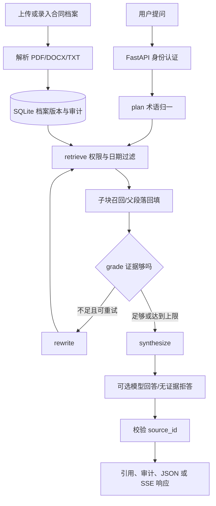

# Financial Agent：合同与合规档案学习项目

这个仓库以**虚构档案**复现一个可运行的问答链路：上传/入库 → 租户与权限过滤 → 章节父子块 → BM25 召回 → LangGraph 规划与证据判断 → 带版本引用的回答 → 审计记录。Milvus、BGE、HyDE、RAGAS、Text2SQL 和代码审查放在独立练习模块，避免实验依赖影响主服务。

**每日学习入口：** [21 天每日代码导读](docs/21天每日代码导读.md)。每天都有要看的函数、关键逻辑、运行命令和能讲清的边界。

## 主链路



| 模块 | 文件 | 要看什么 |
| --- | --- | --- |
| HTTP 入口 | [app/main.py](app/main.py) | 入库、问答、SSE 与权限检查 |
| 状态图 | [app/agent/graph.py](app/agent/graph.py)、[nodes.py](app/agent/nodes.py) | plan / retrieve / grade / rewrite / synthesize |
| 档案解析 | [app/services/parser.py](app/services/parser.py)、[chunker.py](app/parse/chunker.py) | PDF/DOCX 边界、父子块与章节路径 |
| 检索 | [app/services/retrieval.py](app/services/retrieval.py) | 权限先过滤、子块检索、父段落引用、拒答门槛 |
| Prompt/LLM | [app/prompts/loader.py](app/prompts/loader.py)、[v1.yaml](prompts/answer/v1.yaml)、[app/services/llm.py](app/services/llm.py) | 版本加载、结构化输出、引用 ID 校验 |
| 回归 | [eval/run_offline.py](eval/run_offline.py)、[golden.json](eval/golden.json) | 正样本引用与负样本拒答分别统计 |

## 启动主服务

在仓库根目录的 PowerShell 运行：

```powershell
py -3.12 -m venv .venv
.\.venv\Scripts\python.exe -m pip install -r requirements.txt
if (-not (Test-Path .env)) { Copy-Item .env.example .env }
.\.venv\Scripts\python.exe -m uvicorn app.main:app --host 127.0.0.1 --port 8000 --reload
```

另开终端导入虚构档案并提问：

```powershell
.\.venv\Scripts\python.exe -m examples.run_demo --tenant my-demo-001 --question "提前还款需要提前多少天申请？"
```

如果 8000 已被占用，把服务端口改为 8001，并在示例命令加 `--base-url http://127.0.0.1:8001`。接口文档在 `/docs`，健康检查是 `/health/live`、`/health/ready`。重复使用同一 `tenant/doc_id/version` 但改变内容会返回 409；提升版本号或换一个**演示租户**，不要覆盖旧档案。

默认 `LLM_PROVIDER=extractive`，无需外部模型。若启用已获授权的模型服务，在本机 `.env` 配置 `LLM_PROVIDER=openai`、`OPENAI_MODEL`、`OPENAI_API_KEY`、必要时 `OPENAI_BASE_URL`。真实密钥只放 `.env` 或密钥管理系统；`.env` 已被 Git 忽略。

## SSE 与 Vue3

`POST /v1/chat/stream` 输出 `plan / retrieve / grade / rewrite / token / citation / done` 事件。前端在 [web/](web/) 用 `fetch + ReadableStream` 消费 SSE，用 `AbortController` 停止请求。

```powershell
cd web
npm install
npm run dev
```

前端默认代理到后端 8000；如果后端在 8001，先设置 `$env:VITE_API_TARGET='http://127.0.0.1:8001'` 再启动 Vite。**当前 token 事件是在模型回答完成后分块发送**，方便学习 SSE；尚未实现真正的模型逐 token 生成和对正在执行的同步模型请求即时取消。

## 独立练习

```powershell
.\.venv\Scripts\python.exe -m labs.langgraph_control
.\.venv\Scripts\python.exe -m pip install -r labs/requirements-milvus.txt
.\.venv\Scripts\python.exe -m labs.milvus_demo --scope all
.\.venv\Scripts\python.exe -m labs.milvus_demo --scope legal
.\.venv\Scripts\python.exe -m labs.retrieval_enhancement
.\.venv\Scripts\python.exe -m labs.rerank_demo
.\.venv\Scripts\python.exe -m pip install -r labs/requirements-light.txt
.\.venv\Scripts\python.exe -m labs.sql_guard
.\.venv\Scripts\python.exe -m labs.review.reviewer
.\.venv\Scripts\python.exe -m eval.run_offline --top-k 3
.\.venv\Scripts\python.exe -m eval.run_offline --top-k 5
.\.venv\Scripts\python.exe -m eval.compare_prompts
.\.venv\Scripts\python.exe -m pytest -q
```

Milvus 实验用独立的 `data/milvus_lab.db`、50 个虚构片段和 1024 维**哈希占位向量**验证 collection、标量过滤、upsert 与删除。真正 BGE-M3 / Reranker 要额外装 `labs/requirements-models.txt` 并带 `--real-model` 运行；模型较大，首次下载慢。可选 Langfuse 实验只发送虚构数据。RAGAS 四指标使用 [独立依赖环境](eval/requirements-ragas.txt)，详情见每日导读 Day 14。

当前虚构 Golden Dataset 的离线结果：`top_k=3/5` 均为正样本引用 **8/8**、关键事实 **8/8**，负样本拒答 **2/2**。这只说明练习集通过，不代表真实业务准确率或阈值已完成校准。

如已配置外部模型，可显式运行 `.\.venv\Scripts\python.exe -m examples.smoke_live_model`，它用临时库中的虚构档案做一次真实模型调用，不读取本机正式档案。

## 安全与能力边界

- 生产模式必须使用带签名、有效期、发行方和受众校验的 JWT。`X-Demo-*` 身份头和公开演示 Token 仅允许本机练习。
- 查询先做租户、最新生效版本、角色和密级过滤，再打分；无权限片段不会进入 LLM 上下文。审计记录问题哈希和引用版本，不记录问题正文。
- 本地 SQLite + 查询时 BM25 适合练习；大规模服务需持久索引、受控原件存储、备份与数据保留策略。可选 BGE 重排阈值须用真实标注集校准。
- SQL 守卫和 diff 审查是 [labs/](labs/) 下的独立实验，未接入主问答 API，也未自动回写 GitHub/GitLab 评论。
- 原 PDF 布局、扫描件 OCR、Milvus 集群运维、真实模型流取消和企业级前端权限管理尚未实现。不要把学习材料中的团队人数、上线日期或准确率当作本项目证据。
